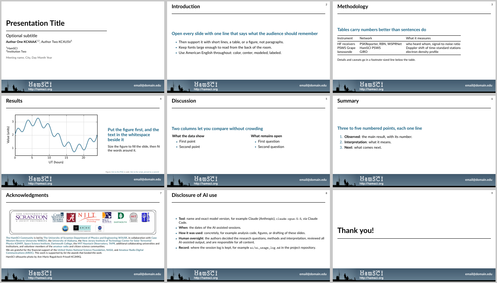

# HamSCI Presentation Templates

Slide templates for presenting HamSCI work, shared across HamSCI projects so talks from the
community look like they belong together.

| Template | Formats | Folder |
|---|---|---|
| Oral presentation (16:9) | PowerPoint, LaTeX Beamer | [`oral/`](oral/) |
| Poster | planned | |

Start with [`oral/README.md`](oral/README.md): it explains how to use the PowerPoint file and the
Beamer theme, lists the theme's commands, and gives a short style guide for HamSCI talks.

## Contributing

Every change goes through a pull request; a maintainer reviews and merges it. When you change
the Beamer theme, rebuild the example talk and its preview in the same pull request
(`oral/example/make_preview.sh`) so the committed PDF matches the source. If you change the
PowerPoint template, carry the change into the Beamer theme too, or open an issue so someone
can.

This repository follows the HamSCI
[`ai_project_template`](https://github.com/HamSCI/ai_project_template): AI-assisted work is
logged in [`ai/ai_usage_log.md`](ai/ai_usage_log.md) before it is committed. New to that
workflow? See [`docs/GETTING_STARTED.md`](docs/GETTING_STARTED.md).

## License

The LaTeX theme, the example and the documentation are released under the MIT License (see
[`LICENSE`](LICENSE)). The images are not covered by that license: the partner logos in
`hamsci_logos.png` belong to their institutions, and the HamSCI silhouette photograph in
`hamsci_banner.png` and the PowerPoint template is by Ann Marie Rogalcheck-Frissell, KC2KRQ.
Use them for HamSCI presentations; ask before using them for anything else.
