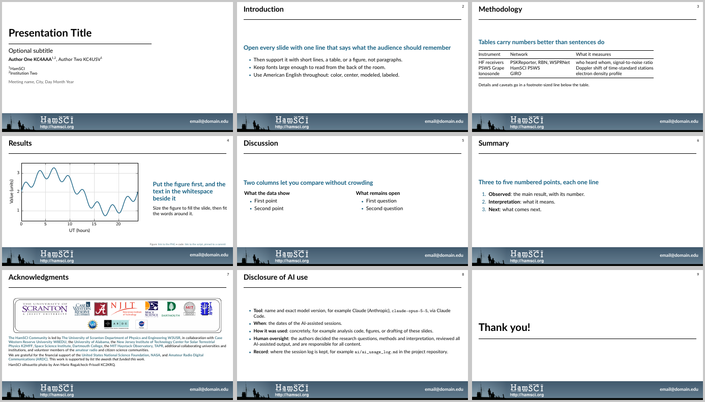

# HamSCI Oral Presentation Template

The HamSCI slide design for talks, in two forms that look the same:

| Folder | What it holds |
|---|---|
| [`pptx/`](pptx/) | `hamsci_oral_template.pptx`, the original 16:9 PowerPoint template |
| [`beamer/`](beamer/) | `beamerthemeHamSCI.sty`, a LaTeX Beamer theme that reproduces it, with its two images |
| [`example/`](example/) | `hamsci_example_talk.tex`, a worked example, and its built PDF |



## PowerPoint

Open `pptx/hamsci_oral_template.pptx` and save a copy under your talk's name. It has three
layouts (Title Slide, Title and Content, Subtitle) and eight starter slides: title, Introduction,
Methodology, Results, Discussion, Summary, Acknowledgments and "Thank you!". It also opens in
Keynote, LibreOffice Impress and Google Slides.

## LaTeX Beamer

### Quick start

Copy `example/hamsci_example_talk.tex` as a starting point. A minimal talk is:

```latex
\documentclass[aspectratio=169,10pt]{beamer}
\usetheme{HamSCI}
\title{Presentation Title}
\author{\textbf{Author One KC4AAA}\textsuperscript{1}}
\institute{\textsuperscript{1}HamSCI}
\date{Meeting, Day Month Year}
\hamscicontact{email@domain.edu}

\begin{document}
\hamscititleframe
\begin{frame}{Introduction}
\hamscitakeaway{The one thing to remember from this slide}
...
\end{frame}
\hamsciacknowledgments[This work is supported by ...]
\hamscisectionframe{Thank you!}
\end{document}
```

Build with `latexmk` or `pdflatex`. The theme needs the `lato`, `tikz` and `hyperref` packages,
all in TeX Live and on Overleaf. The example also uses `booktabs` and `pgfplots`.

### Making the theme available

LaTeX has to find three files: `beamerthemeHamSCI.sty`, `hamsci_banner.png` and
`hamsci_logos.png`. Pick one way:

1. **Copy them** next to your `.tex` file. This is the simplest, and the only way on Overleaf
   (upload the three files to the project).
2. **Point `TEXINPUTS` at a checkout** of this repository. With `latexmk`, put a `latexmkrc` next
   to your `.tex`:
   ```perl
   ensure_path('TEXINPUTS', '/path/to/presentation_templates/oral/beamer//');
   ```
   The example talk does this with a relative path.
3. **Add this repository as a git submodule** of your project, then use a relative path in
   `latexmkrc` as in option 2:
   ```bash
   git submodule add git@github.com:HamSCI/presentation_templates.git presentation_templates
   ```
4. **Install the theme for your user account**, once per machine:
   ```bash
   dest="$(kpsewhich -var-value TEXMFHOME)/tex/latex/hamsci"
   mkdir -p "$dest" && cp oral/beamer/* "$dest/"
   ```

### Commands

| Command | What it does |
|---|---|
| `\hamscicontact{...}` | Contact line in white at the right of the banner, on every slide |
| `\hamscititleframe` | The title slide: title, rule, optional subtitle, authors, affiliations, date |
| `\hamscitakeaway{...}` | The bold one-line takeaway that opens a content slide, in the accent color |
| `\hamscisource{...}` | A small gray note at bottom right, above the banner: figure source, data credit or code link |
| `\hamscisectionframe{...}` | A large title over a full-width rule, as in the "Subtitle" layout: section dividers and "Thank you!" |
| `\hamsciacknowledgments[...]` | The template's Acknowledgments slide with partner logos; the optional argument adds a sentence, such as this work's award numbers |

The colors are available by name: `hamsciaccent` (`#156082`), `hamscilink` (`#467886`) and
`hamscigrey` (`#595959`).

## Style guide

These habits make HamSCI talks easy to follow. The example talk shows each of them.

- **One takeaway per slide.** Open each content slide with a one-line `\hamscitakeaway`, then
  support it with short lines, a table or a figure. Avoid paragraphs.
- **Numbers go in tables.** Put caveats and details in a small line below the table.
- **Make figures as large as possible.** Put text in the whitespace beside a figure, not below
  it. Fonts must read from the back of the room.
- **Link each figure to its source.** A `\hamscisource` note can link to the image and the code
  that made it, pinned to a fixed commit so the link keeps working.
- **Write for people outside your project.** Leave out internal shorthand such as pull request
  or issue numbers, and do not discuss data the talk does not use.
- **Use American English:** color, center, gray, modeled, labeled.
- **Credit the people behind the data.** Thank transmitter and receiver operators by name and
  callsign, never with addresses or email addresses (see `.claude/rules/hamsci-data.md`).
- **List the funding.** Add this work's award numbers to the Acknowledgments slide.
- **Disclose AI use.** If AI tools helped make the talk or the work in it, include the
  "Disclosure of AI use" slide from the example and keep it accurate.

## Updating the example

After changing the theme or the example, rebuild the PDF in the same commit so the two agree,
and refresh the README preview. `example/make_preview.sh` does both (it needs `latexmk`,
`pdftoppm` and ImageMagick's `montage`).
