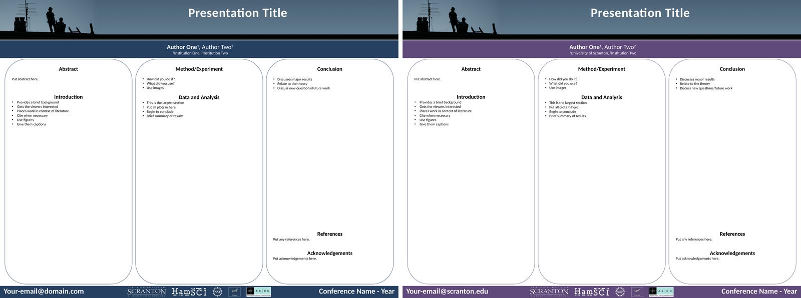

# HamSCI Poster Template

The HamSCI poster design, a landscape PowerPoint template, in two versions and two sizes:

| For | Accent color | 48 × 36 in (original) | 44 × 36 in (AGU-compliant) |
|---|---|---|---|
| everyone | HamSCI blue `#254160` | [`hamsci_poster_template.pptx`](pptx/hamsci_poster_template.pptx) | [`hamsci_poster_template_44in.pptx`](pptx/hamsci_poster_template_44in.pptx) |
| University of Scranton authors | Scranton purple `#5F4A7A` | [`hamsci_scranton_poster_template.pptx`](pptx/hamsci_scranton_poster_template.pptx) | [`hamsci_scranton_poster_template_44in.pptx`](pptx/hamsci_scranton_poster_template_44in.pptx) |

AGU limits posters to 44 in wide in 2026, so use a `_44in` file for AGU. The 44 in versions are
the same height, with the same font sizes and the same vertical layout. Only the width changes: each column
narrows from 15.3 in to 14.0 in, the banner photo loses 4 in of empty sky on its right edge (it is
cropped, not squashed), and the title, bars and footer follow. Check your meeting's own size
limits before printing.



The layout is the same in both: the rooftop-silhouette banner with the title, an author and
affiliation bar, three rounded columns (Abstract and Introduction; Method/Experiment and Data
and Analysis; Conclusion, References and Acknowledgements), and a footer with the contact
email, partner logos and conference name. The Scranton version fills in "University of
Scranton" as the first affiliation and a `@scranton.edu` email.

## Using it

Open the template for your group and save a copy under your poster's name. Replace the
placeholder text, and keep "Data and Analysis" the largest section. The 48 in version is 4:3,
so a printer can scale it to any other 4:3 size; the 44 in version is 11:9. For a different shape, change the slide size
before adding content.

## Converting a 48 in poster to 44 in

For a poster you have already built on the 48 in template, the safest route is to start a
`_44in` template and paste your content in, column by column. Your figures will need resizing
for the narrower columns.

To keep the poster 36 in tall, [`tools/poster_44in.py`](tools/poster_44in.py) re-lays a finished
poster out on the 44 in template's geometry: the banner photo is cropped 4 in at the right, the
three columns move to the 44 in template's positions, and the title, author bar and footer keep
their font sizes. Inside the columns, fonts, pictures and indents scale by 0.915 (28 pt becomes
25.6 pt), so every text box wraps exactly as it did at 48 in and nothing overflows:

```bash
python3 poster/tools/poster_44in.py my_poster.pptx my_poster_44in.pptx            # 44 × 36 in
python3 poster/tools/poster_44in.py my_poster.pptx my_poster_44in.pptx --keep-fonts  # re-flow by hand
```

It works best on a poster built from these templates, since it finds the banner, title, bars and
footer by their template names. If a long title wraps onto an extra line, or footer items collide,
nudge them in PowerPoint. It needs only Python 3.

For an even quicker conversion, [`tools/scale_pptx.py`](tools/scale_pptx.py) shrinks the
whole poster evenly to a new width, so nothing has to be redone. The poster comes out 44 × 33 in, with fonts at 11/12 size (28 pt becomes 25.67 pt):

```bash
python3 poster/tools/scale_pptx.py my_poster.pptx my_poster_44in.pptx            # 44 × 33 in
python3 poster/tools/scale_pptx.py my_poster.pptx my_poster_40in.pptx --width 40  # any width
```

It needs only Python 3. Open the result in PowerPoint and check it before you print.

## Regenerating the 44 in templates

The `_44in` files are made from the 48 in ones by
[`tools/make_44in_templates.py`](tools/make_44in_templates.py). After changing a 48 in template,
run `python3 poster/tools/make_44in_templates.py` and check both 44 in files in PowerPoint. The
script finds shapes by their names in the template, so if you rename or add shapes, update it.

## Keeping the file small

The templates are about 5 MB. As first made they were about 70 MB, almost all of it one
picture: the banner photo, stored as a 19355 × 2592 PNG with an unused transparency channel,
59 % of it hidden by PowerPoint's crop. [`tools/shrink_pptx.py`](tools/shrink_pptx.py) trims
the hidden part, drops the unused channel, and saves the photo as a quality-95 JPEG at full
resolution (about 320 dpi as printed). That shows no visible difference, including in the sky
gradient.

Your poster's own large pictures can bloat it the same way. If a poster grows past a few tens of
MB, run:

```bash
python3 poster/tools/shrink_pptx.py my_poster.pptx my_poster_small.pptx
```

It only touches PNGs over 2 MB that have no transparency, and it leaves everything else alone.
`--max-dpi 200` also downsamples images shown above 200 dpi, which is still plenty for a
poster. Open the result in PowerPoint and check it before you print. The script needs Python 3
and Pillow (`pip install pillow`).

## Images

As in the oral template, the rooftop silhouette photograph is by Ann Marie
Rogalcheck-Frissell, KC2KRQ, and the partner logos belong to their institutions. They are not covered by the MIT license; use
them for HamSCI posters.
